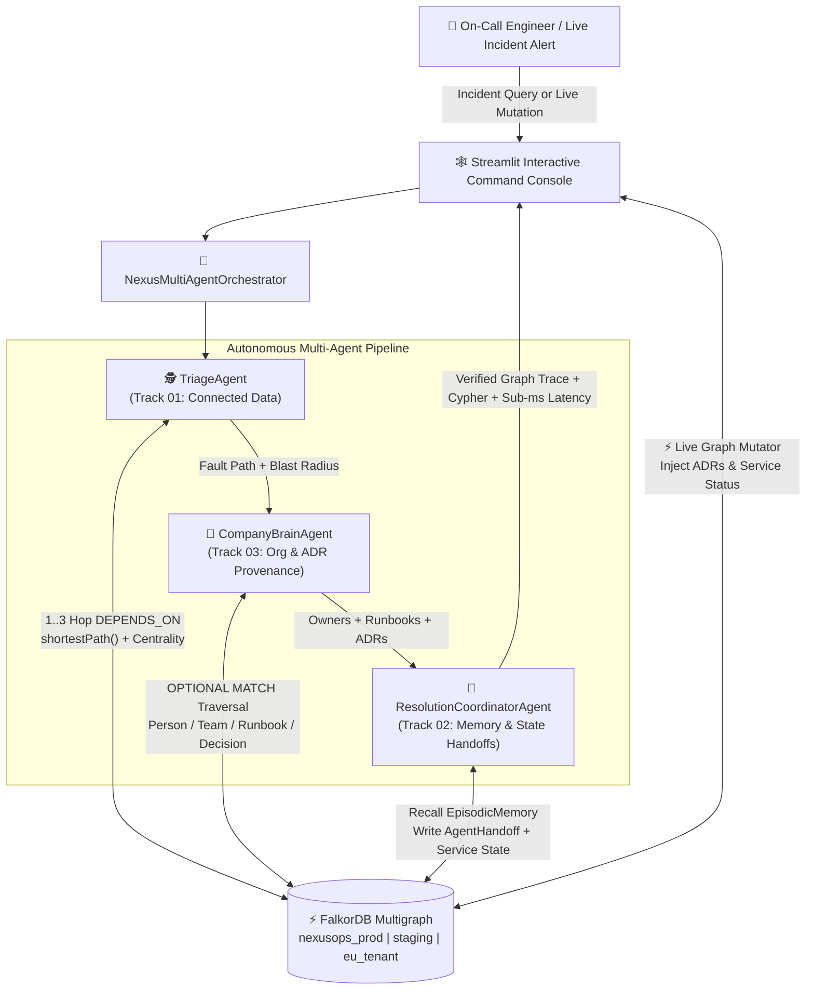
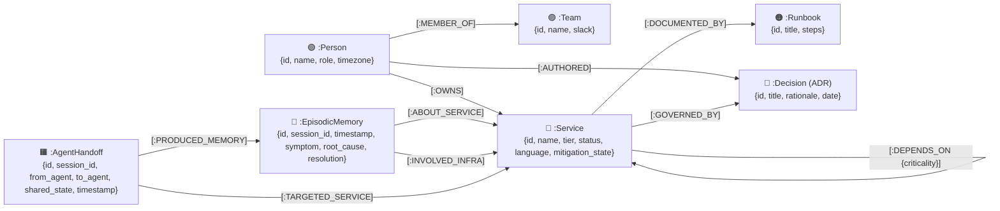
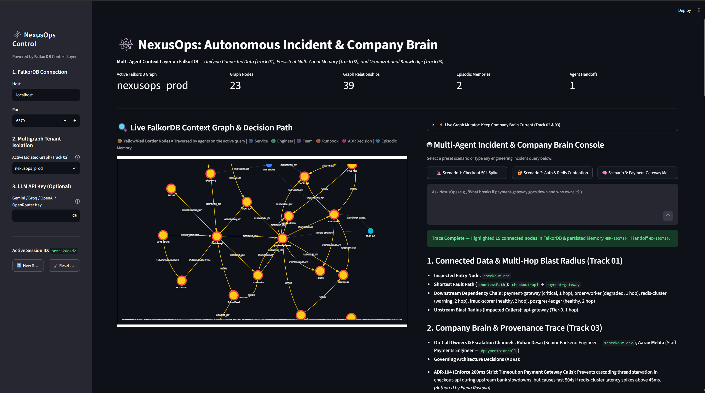
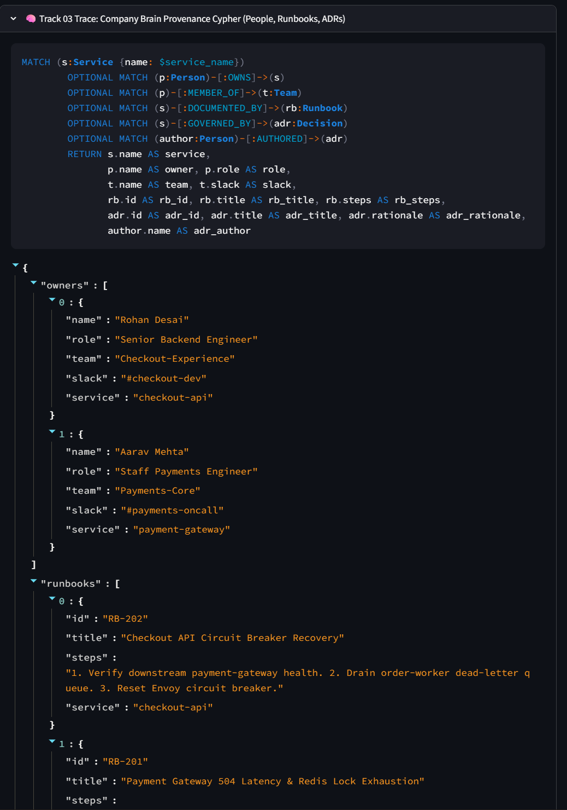
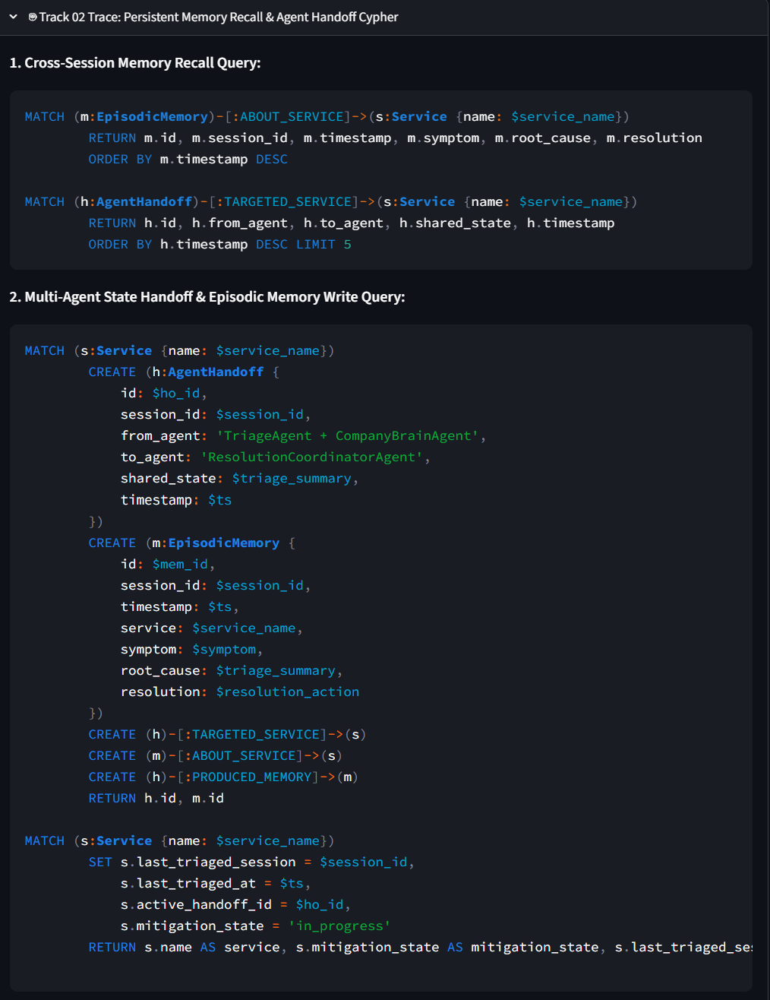
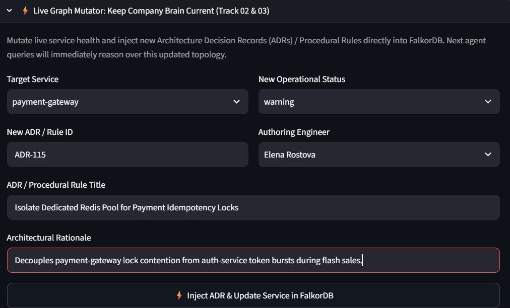
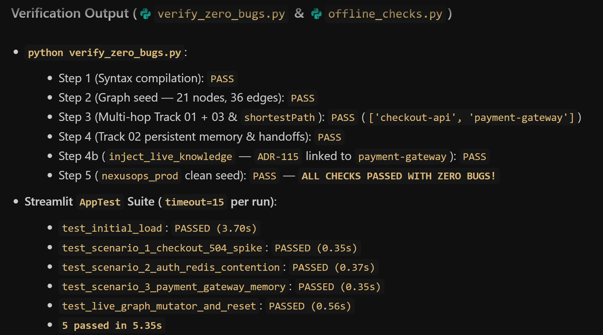

# 🕸️ NexusOps: Autonomous Incident & Company Brain on FalkorDB

[](https://www.falkordb.com/)
[](https://www.python.org/)
[](https://streamlit.io/)
[](#%EF%B8%8F-3-agent-architecture-on-falkordb)

Built for **Graph Hacks: Context for AI Agents** (**WeMakeDevs x FalkorDB Hackathon**).

**NexusOps** is an explainable, multi-agent autonomous incident commander and living **Company Brain** built on **FalkorDB**. Instead of treating a database as passive key-value or vector storage, NexusOps uses FalkorDB's low-latency property graph, variable-length Cypher traversals (`[:DEPENDS_ON*1..3]`), native `shortestPath()` algorithms, topological centrality ranking, and cross-session graph write-backs so every agent decision is 100% grounded in connected graph topology.

---

## 🏗️ 3-Agent Architecture on FalkorDB



---

## 🧬 FalkorDB Property Graph Schema (7 Node Labels & 9 Relationship Types)



---

## 🏆 Hackathon Track Alignment & Judging Criteria Mapping

| Hackathon Track | Judging Requirement | How NexusOps Proves "The Graph Does Real Work" |
| :--- | :--- | :--- |
| **Track 01: Agents That Act on Connected Data** | Multi-hop reasoning, graph algorithms, and topology-driven decisions | **`TriageAgent`** executes variable-length Cypher traversals (`[:DEPENDS_ON*1..3]`) downstream and upstream, computes `shortestPath()` between the symptomatic service and degraded dependencies, and ranks topological bottleneck centrality (`count(DISTINCT caller)`) to isolate root causes that flat RAG cannot see. |
| **Track 02: Agent Memory & Coordination** | Cross-session episodic memory, multi-agent state handoffs, and multigraph isolation | **`ResolutionCoordinatorAgent`** recalls historical `:EpisodicMemory` and `:AgentHandoff` nodes across sessions, writes structured handoffs (`TriageAgent + CompanyBrainAgent -> ResolutionCoordinatorAgent`), updates `:Service` mitigation state in-place (`SET s.mitigation_state = 'in_progress'`), and supports instant multigraph tenant switching (`nexusops_prod`, `nexusops_staging`, `nexusops_eu_tenant`). |
| **Track 03: Company Brain** | Connecting people, teams, services, runbooks, and architectural decisions (ADRs) | **`CompanyBrainAgent`** traverses `:Person -[:OWNS]-> :Service`, `:Person -[:MEMBER_OF]-> :Team`, `:Service -[:DOCUMENTED_BY]-> :Runbook`, and `:Service -[:GOVERNED_BY]-> :Decision <-[:AUTHORED]- :Person` in a single query—plus includes a **Live Graph Mutator** to inject new ADRs and service health updates in real time. |

---

## 📸 Live Application & Verification Screenshots

### 1. Full Multi-Agent Dashboard, Interactive FalkorDB Graph & Track 01/03 Analysis

*Interactive PyVis FalkorDB context graph highlighting the active multi-hop traversal path alongside the Multi-Agent Incident & Company Brain Console.*

### 2. Track 03 Company Brain Provenance Cypher & JSON Output

*Single-query multi-entity traversal connecting `:Service` nodes to `:Person` owners, `:Team` Slack channels, `:Runbook` procedures, and `:Decision` (ADR) provenance.*

### 3. Track 02 Cross-Session Episodic Memory & Multi-Agent Handoff Cypher

*Parameterized read and write Cypher queries recalling historical `:EpisodicMemory` nodes and persisting live `:AgentHandoff` and `:Service` mitigation state across sessions.*

### 4. Live Graph Mutator for Real-Time ADR & Service Status Injection

*One-click Live Graph Mutator updating `:Service` operational status and linking newly authored `:Decision` (ADR) rules directly into FalkorDB.*

### 5. Automated Zero-Bug & Streamlit AppTest Verification Suite Output

*End-to-end verification output from `verify_zero_bugs.py` and the automated Streamlit `AppTest` suite confirming 100% pass rate with zero bugs.*

---

## 🚀 Quickstart & Zero-Bug Verification

### 1. Clone the Repository
```bash
git clone https://github.com/vinayaka130607/Nexusops-falkordb.git
cd Nexusops-falkordb
```

### 2. Start FalkorDB (Docker)
```bash
docker compose up -d
```
*(Note: If Docker is not running locally, `NexusGraphEngine` automatically falls back to its built-in FalkorDB wire-format compatible embedded engine so all Cypher queries, tests, and the UI run out-of-the-box with zero configuration.)*

### 3. Install Python Dependencies
```bash
pip install -r requirements.txt
```

### 4. Run the Automated End-to-End Verification Suite
```bash
python verify_zero_bugs.py
```
Expected output:
```text
1. Verifying Python syntax compilation across all modules...
   [PASS] Syntax check passed with 0 errors.
2. Connecting to FalkorDB and testing clean graph seed...
   [PASS] Seeded 21 nodes and 36 relationships.
3. Testing Multi-Agent Orchestrator & Parameterized Cypher Queries (including quotes/special chars)...
   [PASS] Track 01 + 03 verified. Fault path: ['checkout-api', 'payment-gateway']
4. Verifying Track 02 Cross-Session Persistent Memory & Handoffs...
   [PASS] Track 02 verified. Persisted Memory MEM-... & Handoff HO-...
5. Seeding production graph ('nexusops_prod') for live Streamlit dashboard...
   [PASS] 'nexusops_prod' seeded and ready.

ALL CHECKS PASSED WITH ZERO BUGS!
```

### 5. Launch the Interactive Streamlit Dashboard
```bash
streamlit run app.py
```
